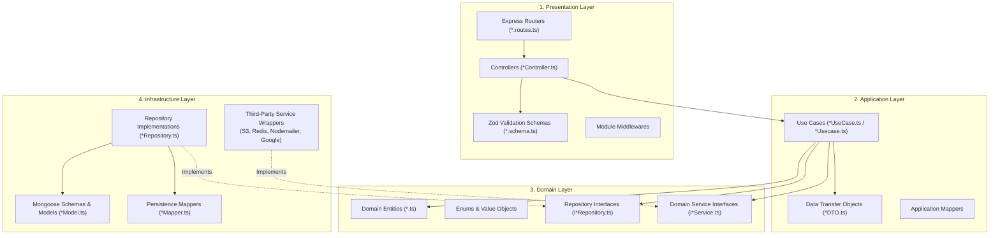
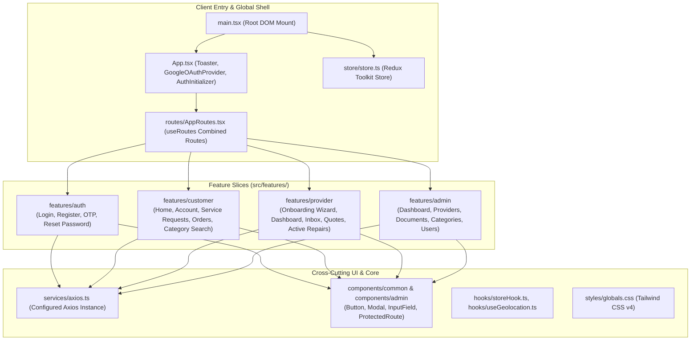
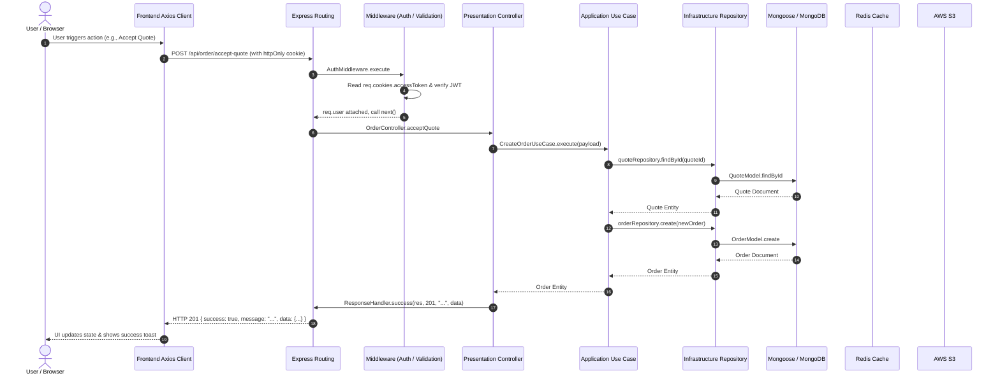

# AtHand — System Architecture

## 1. Architectural Philosophy

AtHand is structured around **Clean Architecture** and **Domain-Driven Design (DDD)** principles on the backend, paired with a feature-sliced modular architecture on the React frontend. 

The primary architectural goal is decoupling core business logic from frameworks, external libraries, and delivery mechanisms.

---

## 2. High-Level System Architecture

```mermaid
flowchart TB
    subgraph Client["Frontend Client (React 19 + Vite)"]
        UI["React SPA (React Router v7)"]
        RTK["Redux Toolkit Store\n(Auth, Provider, Admin)"]
        AxiosClient["Axios HTTP Client\n(withCredentials: true)"]
        UI --> RTK
        UI --> AxiosClient
    end

    subgraph CDN_Cloud["External Cloud Infrastructure"]
        S3["AWS S3 Bucket\n(Document & Repair Media Storage)"]
        GoogleAuth["Google Identity Services\n(OAuth2 Verification)"]
        SMTP["Google SMTP / Nodemailer\n(Email & OTP Delivery)"]
    end

    subgraph Server["Backend Server (Node.js + Express 5)"]
        App["Express Application (app.ts)"]
        Middlewares["Global Middlewares\n(CORS, CookieParser, BodyParsers, ErrorHandler)"]
        Containers["Composition Roots (container.ts)\nManual Dependency Injection"]
        Controllers["Presentation Controllers"]
        UseCases["Application Use Cases"]
        Entities["Domain Entities & Contracts"]
        Repos["Infrastructure Repositories"]
        
        App --> Middlewares --> Controllers --> UseCases --> Entities
        UseCases --> Repos
        Containers -.->|Instantiates & Wires| Controllers
        Containers -.->|Instantiates & Wires| UseCases
        Containers -.->|Instantiates & Wires| Repos
    end

    subgraph DataTier["Data Tier"]
        MongoDB[(MongoDB Database\n(Mongoose 9, 2dsphere Indexes))]
        Redis[(Redis Cache\n(Refresh Tokens, OTP, Password Reset))]
    end

    AxiosClient -->|REST API over HTTP/JSON\nCookies: JWT Access & Refresh| App
    Repos -->|Mongoose Queries| MongoDB
    UseCases -->|Cache, TTL, Revocation| Redis
    UseCases -->|Presigned URLs| S3
    UseCases -->|Verify Token ID| GoogleAuth
    UseCases -->|Dispatch Email/OTP| SMTP
    AxiosClient -->|Direct S3 Upload via Presigned URL| S3
```

---

## 3. Backend Architecture: Clean Architecture & DDD Layers

The backend codebase (`server/src`) is partitioned into bounded modules under `src/modules/` and shared cross-cutting concerns under `src/shared/`. Each module is strictly segmented into four conceptual concentric layers:



### Layer Responsibilities

1. **Domain Layer (`domain/`)**:
   - Contains pure enterprise business logic and contracts.
   - Contains Domain Entities (e.g., `User`, `Provider`, `ServiceRequest`, `Quote`, `OrderEntity`), domain enums (`OrderStatus`, `ServiceRequestStatus`, `ProviderStatus`), and abstract interfaces (`IUserRepository`, `IOrderRepository`, `ITokenService`).
   - Free from external dependencies (no Express, no Mongoose, no AWS SDK).

2. **Application Layer (`application/`)**:
   - Implements use cases (single responsibility classes implementing `IUsecase<Input, Output>`).
   - Orchestrates domain entities and interfaces.
   - Defines request/response DTOs to encapsulate boundaries.

3. **Infrastructure Layer (`infrastructure/`)**:
   - Houses database implementations, Mongoose models, database mappers, Redis storage adapters, and external API wrappers.
   - Converts between Mongoose documents and pure Domain entities using explicit `toDomain()` and `toPersistence()` mappers.

4. **Presentation Layer (`presentation/`)**:
   - Delivers the application via HTTP/REST.
   - Contains Express routers, route constants, controllers, input validation middleware (powered by Zod), and HTTP response serialization (`ResponseHandler`).

5. **Composition Root (`container.ts`)**:
   - Every module has a `container.ts` that explicitly instantiates repositories, services, use cases, and controllers, injecting dependencies from the bottom up.
   - No runtime reflection or dynamic dependency injection library is used; wiring is compile-time type-checked.

---

## 4. Frontend Architecture: Feature-Sliced React 19

The frontend (`client/src`) is organized around features rather than technical layers:



### State Management Strategy

The frontend combines four distinct state tiers:
1. **Global Shared State (Redux Toolkit)**:
   - `authSlice`: Currently logged in user identity, roles, verification state, and loading flags.
   - `adminSlice`: Administrator identity and authentication flag.
   - `providerSlice`: Approved provider profile data for technician mode.
   - `providerApplicationSlice`: Multi-step form draft data during technician onboarding.
2. **Server Cache / Remote State**:
   - Managed locally inside components using `useState` and `useEffect` hooks paired with feature API services (`serviceRequestApi`, `orderApi`, `adminApi`).
3. **Local UI State**:
   - Component-level state (`useState`, `useReducer`) for modals, active image carousels, active tabs, and input states.
4. **Form State**:
   - Managed via `react-hook-form` paired with `@hookform/resolvers/zod` for validation against declarative Zod schemas.

---

## 5. Request & Response Lifecycle

The typical lifecycle of an API request through the AtHand stack:



---

## 6. Authentication Architecture

AtHand uses a dual-context JWT architecture with token storage in `httpOnly` cookies:

```mermaid
flowchart TD
    subgraph AuthChannels["Authentication Gateways"]
        StandardLogin["POST /api/auth/login\n(Email & Password)"]
        GoogleLogin["POST /api/auth/google\n(Google ID Token verification)"]
        AdminLogin["POST /api/auth/login\n(context: 'ADMIN')"]
        SignupFlow["POST /api/auth/signup\n(Triggers OTP via Nodemailer)"]
        OtpVerify["POST /api/auth/verify-otp\n(Validates Redis OTP + registrationToken)"]
    end

    subgraph CookieStore["Client Cookie Jar (httpOnly, sameSite: 'lax')"]
        UserAccess["accessToken (15m TTL)"]
        UserRefresh["refreshToken (7d TTL)"]
        AdminAccess["adminAccessToken (15m TTL)"]
        AdminRefresh["adminRefreshToken (7d TTL)"]
        RegCookie["registrationToken (15m TTL)"]
    end

    subgraph RedisStore["Redis Database"]
        RedisSession["refresh:{userId}:{sessionId} -> refreshToken\n(7-day expiry)"]
        RedisOtp["otp:{email} -> 6-digit code\n(60-second expiry)"]
        RedisReset["password_reset:{token} -> userId\n(15-minute expiry)"]
    end

    StandardLogin --> UserAccess
    StandardLogin --> UserRefresh
    StandardLogin --> RedisSession

    GoogleLogin --> UserAccess
    GoogleLogin --> UserRefresh
    GoogleLogin --> RedisSession

    AdminLogin --> AdminAccess
    AdminLogin --> AdminRefresh
    AdminLogin --> RedisSession

    SignupFlow --> RegCookie
    SignupFlow --> RedisOtp

    OtpVerify --> UserAccess
    OtpVerify --> UserRefresh
    OtpVerify --> RedisSession
```


