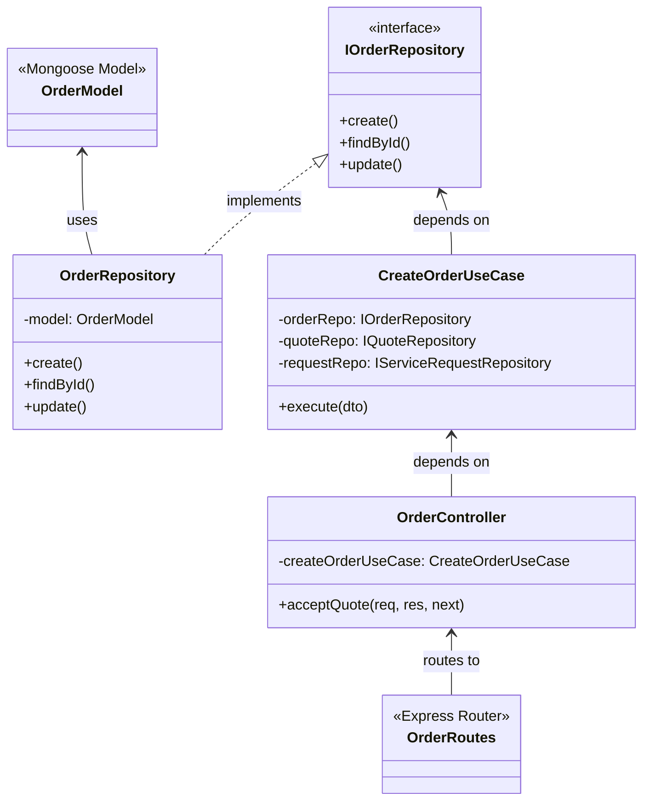

# AtHand — Backend Architecture & Clean Architecture Implementation

## 1. Clean Architecture & Domain-Driven Design (DDD)

The backend follows an explicit Domain-Driven Design (DDD) and Clean Architecture pattern. The codebase separates business rules from database schemas, HTTP frameworks, and third-party libraries.

```
server/src/modules/<module-name>/
├── container.ts                    # Composition Root (Dependency Injection)
├── application/                    # Application Business Rules
│   ├── dtos/                       # Data Transfer Objects
│   ├── mappers/                    # Application DTO Mappers
│   └── usecases/                   # Single-responsibility Use Cases
├── domain/                         # Enterprise Business Rules & Core Entities
│   ├── entities/                   # Pure Domain Entities
│   ├── enums/                      # Domain Enumerations
│   ├── repositories/               # Abstract Repository Interfaces (Ports)
│   └── services/                   # Abstract Service Interfaces
├── infrastructure/                 # Frameworks, Drivers & Adapters
│   ├── database/
│   │   ├── mappers/                # Persistence Mappers (toDomain / toPersistence)
│   │   ├── models/                 # Mongoose Schemas & Models
│   │   └── repositories/           # Concrete Repository Implementations (Adapters)
│   └── services/                   # Concrete Service Implementations (S3, Nodemailer, etc.)
└── presentation/                   # Interface Adapters (Delivery Mechanism)
    ├── constants/                  # Route paths and response strings
    ├── controllers/                # HTTP Controllers
    ├── middlewares/                # Module-specific middlewares
    ├── routes/                     # Express Router definitions
    └── validators/                 # Zod Request Body Schemas
```

---

## 2. Dependency Inversion & Composition Root Pattern (`container.ts`)

Instead of utilizing heavy runtime IoC container libraries (e.g. InversifyJS, TypeDI) or framework-bound decorators, AtHand implements **pure compile-time Dependency Injection** via a dedicated `container.ts` composition root per module.

### Dependency Flow Example: `src/modules/order/container.ts`



### Instantiation Code Pattern in `container.ts`:
```typescript
// 1. Concrete Repositories (Infrastructure)
const orderRepository = new OrderRepository();
const quoteRepository = new QuoteRepository();
const serviceRequestRepository = new ServiceRequestRepository();

// 2. Use Cases (Application) - Injected with Repositories
const createOrderUseCase = new CreateOrderUseCase(orderRepository, quoteRepository, serviceRequestRepository);
const submitDiagnosisUseCase = new SubmitDiagnosisUseCase(orderRepository);

// 3. Controllers (Presentation) - Injected with Use Cases
const orderController = new OrderController(
    createOrderUseCase,
    submitDiagnosisUseCase,
    // ...
);

// 4. Routes (Presentation) - Wires Controller methods
export const orderRoutes = createOrderRoutes(orderController, authMiddleware);
```

---

## 3. Data Mapping Architecture

To prevent database implementation details (e.g. Mongoose `_id`, `__v`, internal document methods) from leaking into business logic, the application uses **Persistence Mappers**:

```typescript
// Example from src/modules/service-request/infrastructure/mappers/ServiceRequestMapper.ts
export class ServiceRequestMapper {
    static toDomain(doc: any): ServiceRequest {
        return new ServiceRequest(
            doc._id.toString(),
            doc.userId.toString(),
            doc.categoryId.toString(),
            doc.address,
            doc.title,
            doc.description,
            doc.urgency,
            doc.onSite,
            doc.media || [],
            doc.status,
            doc.productBrand,
            doc.productModel,
            doc.preferredDate,
            doc.preferredTimeSlot,
            doc.createdAt,
            doc.updatedAt
        );
    }

    static toPersistence(entity: ServiceRequest): any {
        return {
            userId: entity.userId,
            categoryId: entity.categoryId,
            address: entity.address,
            title: entity.title,
            description: entity.description,
            urgency: entity.urgency,
            onSite: entity.onSite,
            media: entity.media,
            status: entity.status,
            productBrand: entity.productBrand,
            productModel: entity.productModel,
            preferredDate: entity.preferredDate,
            preferredTimeSlot: entity.preferredTimeSlot
        };
    }
}
```

---

## 4. Base Repository Abstraction (`BaseRepository<T>`)

Shared database operations are encapsulated in `server/src/shared/infrastructure/database/BaseRepository.ts`:

```typescript
export abstract class BaseRepository<T> {
    constructor(protected model: Model<T>) { }
    
    protected async createDocument(data: Partial<T>): Promise<T>;
    protected async findDocumentById(id: string): Promise<T | null>;
    protected async findDocumentByEmail(email: string): Promise<T | null>;
    protected async updateDocument(id: string, updateData: UpdateQuery<T>): Promise<T | null>;
    protected async findAllDocuments(): Promise<T[] | null>;
}
```

---

## 5. Internal Scaffolding Tool (`server/cli/`)

The repository includes a custom CLI generator to accelerate Clean Architecture development and ensure architectural consistency:

### CLI Commands (`npm run generate` / `npm run g`)

```bash
# Generate a complete Clean Architecture module with all layers
npm run g resource <name>

# Generate only directory skeleton
npm run g module <name>

# Generate individual layer artifacts
npm run g usecase <module> <usecase-name>
npm run g controller <module> [name]
npm run g repository <module> [name]
npm run g entity <module> [name]
npm run g dto <module> <name>
```

### Generator Architecture (`server/cli/generator.mjs` & `templates.mjs`)
- Uses `commander` for CLI option parsing.
- Uses `pluralize` to dynamically deduce singular and plural names in kebab-case, camelCase, and PascalCase.
- Populates standardized template files (`{{pascal}}UseCase.ts`, `{{pascal}}Controller.ts`, `{{pascal}}Repository.ts`, `container.ts`).
