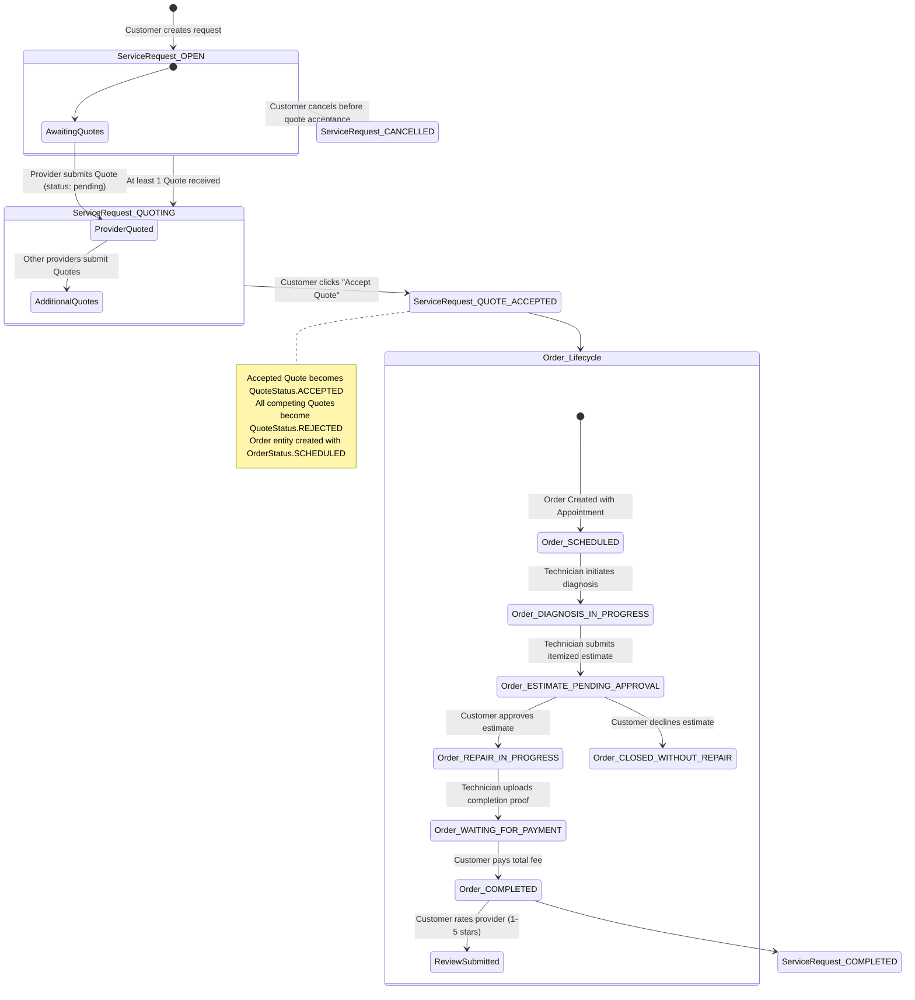
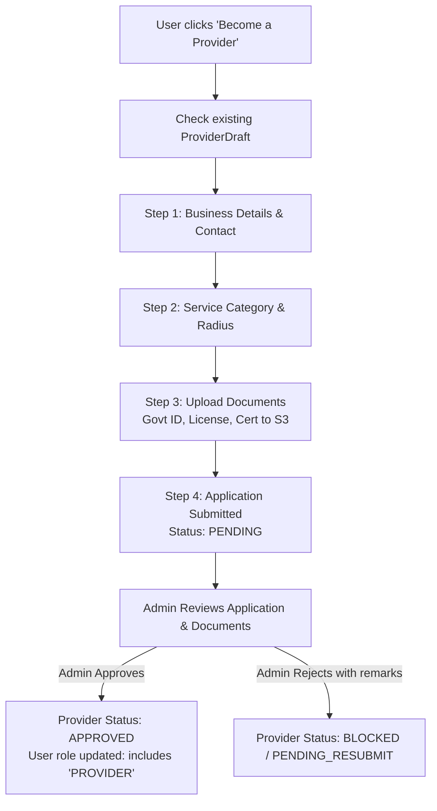

# AtHand — Business Logic & Domain Rules

## 1. Domain Entities & Roles

AtHand defines three primary actor roles in the system (`UserRole`):
1. **`USER` (Customer)**:
   - Registers with email, name, and phone.
   - Creates service requests for broken appliances/devices.
   - Reviews and accepts technician quotes.
   - Approves or declines physical diagnosis repair estimates.
   - Pays for completed repair work and rates technicians.
2. **`PROVIDER` (Technician / Workshop)**:
   - Must have an active `USER` account.
   - Completes onboarding by submitting business details, operating coordinates, service radius, and mandatory credentials.
   - Must be verified and marked `APPROVED` by an Administrator before receiving nearby service requests.
   - Sends quotes, conducts hardware diagnostics, submits itemized estimates, and executes repairs.
3. **`ADMIN` (Platform Operator)**:
   - Verifies provider credentials and documents.
   - Manages service categories, platform commission percentages, and account moderation.

---

## 2. Core Repair Service Lifecycle & State Machines

The central business logic revolves around three tightly coupled state machines: **ServiceRequest**, **Quote**, and **Order**.

---

## 3. Order Status State Transition Rules

The `OrderStatus` state machine enforces strict role authorization and state prerequisites:

| Current Status | Target Status | Allowed Actor | Trigger Action | Business Rules & Invariants |
| :--- | :--- | :--- | :--- | :--- |
| *None* | `SCHEDULED` | Customer | `POST /api/order/accept-quote` | - Request must be `OPEN` or `QUOTING`. - Only request owner can accept. - Cannot accept quote if an Order already exists for the request. - Competing quotes for the request are updated to `rejected`. |
| `SCHEDULED` | `DIAGNOSIS_IN_PROGRESS` | Provider | `PATCH /api/order/:id/diagnosis` | - Only assigned technician can submit. - Captures diagnostic summary and array of identified issues. |
| `DIAGNOSIS_IN_PROGRESS` | `ESTIMATE_PENDING_APPROVAL` | Provider | `PATCH /api/order/:id/estimate` | - Only assigned technician can submit. - Must include itemized parts breakdown, labor cost, total amount, and warranty terms. - Marks `isAmountRevised: true` and sets final amount. |
| `ESTIMATE_PENDING_APPROVAL` | `REPAIR_IN_PROGRESS` | Customer | `PATCH /api/order/:id/estimate-decision` (`APPROVE`) | - Only the ordering customer can approve. - Technician is authorized to commence physical repair. |
| `ESTIMATE_PENDING_APPROVAL` | `CLOSED_WITHOUT_REPAIR` | Customer | `PATCH /api/order/:id/estimate-decision` (`DECLINE`) | - Customer declines the revised repair estimate. - Order terminates without repair; diagnosis fee (if any) applies. |
| `REPAIR_IN_PROGRESS` | `WAITING_FOR_PAYMENT` | Provider | `PATCH /api/order/:id/complete` | - Only assigned technician can submit. - Must provide completion notes and array of work proof photo URLs with captions. |
| `WAITING_FOR_PAYMENT` | `COMPLETED` | Customer | `POST /api/order/:id/payment` | - Customer pays final total amount. - Updates `payment.status = 'PAID'` and sets `transactionReference`. - Automatically updates parent `ServiceRequest.status = 'COMPLETED'`. |
| `COMPLETED` | `COMPLETED` (reviewed) | Customer | `POST /api/order/:id/review` | - Rating must be integer between 1 and 5. - Updates provider's cumulative `averageRating` and `totalReviews`. |

---

## 4. Provider Application & Verification Workflow

### Business Rules for Providers:
1. **Uniqueness**: A user can only submit one provider registration (`userId` unique constraint).
2. **Draft Persistence**: The provider onboarding wizard persists intermediate form data in the `ProviderDraft` collection across sessions until final submission.
3. **Document Requirements**:
   - `TECHNICAL CERTIFICATE`
   - `BUSINESS LICENSE`
   - `GOVERNMENT ID FRONT`
   - `GOVERNMENT ID BACK`
4. **Approval Gate**: Until `status === "APPROVED"`:
   - Technician cannot view nearby requests (`RequestInbox`).
   - Technician cannot quote on customer requests.
   - Provider services are excluded from public nearby queries.

---

## 5. Pricing & Commission Calculation

1. **Initial Quote Pricing**:
   $$\text{Estimated Total} = \text{Labor Cost} + \text{Estimated Parts Cost}$$
2. **Post-Diagnosis Revision**:
   - If initial quote differs from post-diagnosis reality (e.g., unexpected internal hardware damage), the technician submits an itemized repair estimate:
   $$\text{Final Total} = \text{Labor Cost} + \sum (\text{Itemized Parts}) + \text{Other Charges}$$
   - The customer holds full authority to reject this revised total, protecting them from unauthorized upsells.
3. **Platform Commission**:
   - Each `Category` specifies a `commissionPercentage` (e.g., 10% - 15%).
   - Stored in the category entity to compute platform fees on completed orders.

---

## 6. Geospatial Matching Business Rules

1. **Service Radius Filter**:
   - Each provider configures a `serviceRadius` in kilometers (default: 2 km, configurable up to 50 km).
   - Saved with GeoJSON `Point` coordinates in MongoDB: `{ type: "Point", coordinates: [lng, lat] }`.
2. **Nearby Request Discovery**:
   - A service request is visible in a provider's inbox if and only if:
     1. `serviceRequest.categoryId === provider.serviceCategory`
     2. `serviceRequest.status === "OPEN"`
     3. Spatial distance between `serviceRequest.address.coordinates` and `provider.location.coordinates` $\le \text{provider.serviceRadius}$.
     4. `serviceRequest.userId !== provider.userId` (a provider cannot quote on their own request).
