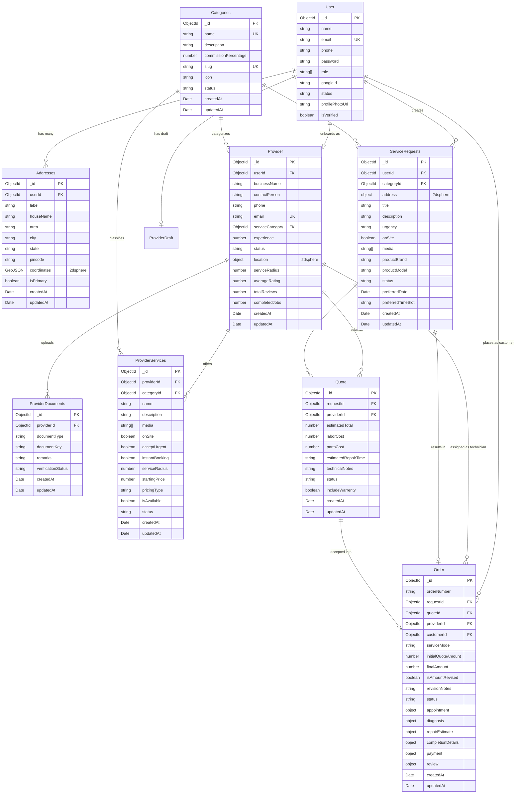

# AtHand — Database Schema & Data Models

## 1. Overview & Connection Architecture

The persistent storage tier for AtHand is **MongoDB**, interfaced via **Mongoose 9.7**. In addition, **Redis 6.1** is employed as an in-memory key-value cache for transient, high-churn session and verification data.

The application uses **GeoJSON Point** geometries paired with **MongoDB 2dsphere spatial indexes** to enable location-based technician matching and nearby service discovery.

---

## 2. Entity-Relationship Diagram (ERD)

---

## 3. Detailed Mongoose Schema Specifications

### 1. `User` Model (`server/src/modules/auth/infrastructure/database/models/UserModel.ts`)
- **Collection**: `users` (Mongoose default for model `"User"`)
- **Timestamps**: Disabled

| Field | Type | Required | Default | Description / Constraints |
| :--- | :--- | :--- | :--- | :--- |
| `name` | `String` | Yes | — | Full name of the user. |
| `email` | `String` | Yes | — | Unique index (`unique: true`). |
| `phone` | `String` | No | — | Contact telephone number. |
| `password` | `String` | Conditional | — | Required if `!this.googleId`. Salted bcrypt hash. |
| `role` | `[String]` | Yes | `["USER"]` | Enum: `["USER", "PROVIDER", "ADMIN"]`. |
| `googleId` | `String` | No | — | Google OAuth subject identifier. |
| `status` | `String` | Yes | `"ACTIVE"` | Enum: `["ACTIVE", "BLOCKED"]`. |
| `profilePhotoUrl` | `String` | No | — | S3 object key or URL for avatar. |
| `isVerified` | `Boolean` | Yes | `false` | Set to `true` upon successful OTP verification. |

---

### 2. `Addresses` Model (`server/src/modules/address/infrastructure/database/models/AddressModel.ts`)
- **Collection**: `addresses`
- **Timestamps**: Enabled (`createdAt`, `updatedAt`)
- **Indexes**: `AddressSchema.index({ coordinates: "2dsphere" })`

| Field | Type | Required | Default | Description / Constraints |
| :--- | :--- | :--- | :--- | :--- |
| `userId` | `ObjectId` | Yes | — | Reference to `Users`. |
| `label` | `String` | Yes | — | Label (e.g. "Home", "Work", "Office"). |
| `houseName` | `String` | Yes | — | House name / Flat number / Apartment building. |
| `area` | `String` | Yes | — | Street or local neighborhood. |
| `city` | `String` | Yes | — | City name. |
| `state` | `String` | Yes | — | State / province. |
| `pincode` | `String` | Yes | — | Postal postal code. |
| `coordinates` | `CoordinatesSchema` | Yes | — | Sub-document: `{ type: "Point", coordinates: [Number] }`. |
| `isPrimary` | `Boolean` | No | `false` | Default address flag. |

---

### 3. `Provider` Model (`server/src/modules/provider/infrastructure/database/models/ProviderModel.ts`)
- **Collection**: `providers`
- **Timestamps**: Enabled
- **Indexes**: `ProviderSchema.index({ "location.coordinates": "2dsphere" })`

| Field | Type | Required | Default | Description / Constraints |
| :--- | :--- | :--- | :--- | :--- |
| `userId` | `ObjectId` | Yes | — | User owning this provider record. |
| `businessName` | `String` | Yes | — | Registered or trading business name. |
| `contactPerson`| `String` | Yes | — | Primary technician or contact person. |
| `phone` | `String` | Yes | — | Business telephone number. |
| `email` | `String` | Yes | — | Unique business email. |
| `serviceCategory`| `ObjectId` | Yes | — | Reference to `Categories`. |
| `experience` | `Number` | No | `0` | Years of industry repair experience. |
| `status` | `String` | Yes | `ProviderStatus.PENDING` | Enum: `["DRAFT", "PENDING", "APPROVED", "BLOCKED"]`. |
| `location` | Sub-document | Yes | — | `{ address: {...}, coordinates: { type: "Point", coordinates: [lng, lat] } }`. |
| `serviceRadius`| `Number` | Yes | `2` | Coverage radius in kilometers. |
| `averageRating`| `Number` | No | `1` | Rating between `0` and `5`. |
| `totalReviews` | `Number` | No | `0` | Cumulative customer reviews count. |
| `completedJobs`| `Number` | No | `0` | Count of successfully closed orders. |

---

### 4. `ProviderDocuments` Model (`server/src/modules/provider/infrastructure/database/models/DocumentModel.ts`)
- **Collection**: `providerdocuments`
- **Timestamps**: Enabled

| Field | Type | Required | Default | Description / Constraints |
| :--- | :--- | :--- | :--- | :--- |
| `providerId` | `ObjectId` | Yes | — | Associated Provider ID. |
| `documentType` | `String` | Yes | — | Enum: `["TECHNICAL CERTIFICATE", "BUSINESS LICENSE", "GOVERNMENT ID FRONT", "GOVERNMENT ID BACK"]`. |
| `documentKey` | `String` | Yes | — | S3 storage key. |
| `remarks` | `String` | No | — | Administrator audit notes / rejection reasons. |
| `verificationStatus` | `String` | Yes | `"PENDING"` | Enum: `["VERIFIED", "PENDING", "REJECTED"]`. |

---

### 5. `ProviderDraft` Model (`server/src/modules/provider/infrastructure/database/models/ProviderDraftModel.ts`)
- **Collection**: `providerdrafts`
- **Timestamps**: Enabled
- **Purpose**: Persists partial onboarding state across user sessions until final verification submission.
- **Fields**: `userId`, `businessDetails` (`businessName`, `contactPerson`, `phone`, `email`), `locationDetails` (`address`, `coordinates`), `serviceDetails` (`serviceCategory`, `serviceRadius`), `documents` (array of sub-documents).

---

### 6. `Categories` Model (`server/src/modules/category/infrastructure/database/models/CategoryModel.ts`)
- **Collection**: `categories`
- **Timestamps**: Enabled

| Field | Type | Required | Default | Description / Constraints |
| :--- | :--- | :--- | :--- | :--- |
| `name` | `String` | Yes | — | Unique category name. |
| `description` | `String` | No | — | Trimmed description. |
| `commissionPercentage`| `Number`| Yes | — | Platform commission fee percentage. |
| `slug` | `String` | Yes | — | Unique lowercase URL-safe slug. |
| `icon` | `String` | No | — | Lucide icon name or image URL. |
| `status` | `String` | Yes | `"ACTIVE"` | Enum: `["ACTIVE", "BLOCKED"]`. |

---

### 7. `ProviderServices` Model (`server/src/modules/provider-service/infrastructure/database/models/ProviderServiceModel.ts`)
- **Collection**: `providerservices`
- **Timestamps**: Enabled

| Field | Type | Required | Default | Description / Constraints |
| :--- | :--- | :--- | :--- | :--- |
| `providerId` | `ObjectId` | Yes | — | Reference to `Providers`. |
| `categoryId` | `ObjectId` | Yes | — | Reference to `Categories`. |
| `name` | `String` | Yes | — | Service name (e.g., "Screen Replacement"). |
| `description` | `String` | No | — | Detailed service scope. |
| `media` | `[String]` | No | `[]` | Array of S3 image keys. |
| `onSite` | `Boolean` | No | `false` | Whether technician travels to customer location. |
| `acceptUrgent` | `Boolean` | No | `false` | Emergency call-out availability. |
| `instantBooking`| `Boolean` | No | `false` | Direct scheduling availability. |
| `serviceRadius`| `Number` | No | `0` | Specific radius for this individual service. |
| `startingPrice`| `Number` | Yes | — | Base charge. |
| `pricingType` | `String` | Yes | — | Enum: `["HOURLY", "FLAT_FEE"]`. |
| `isAvailable` | `Boolean` | No | `true` | Availability toggle. |
| `status` | `String` | No | `"ACTIVE"` | Enum: `["ACTIVE", "INACTIVE", "BLOCKED"]`. |

---

### 8. `ServiceRequests` Model (`server/src/modules/service-request/infrastructure/database/models/ServiceRequestModel.ts`)
- **Collection**: `servicerequests`
- **Timestamps**: Enabled
- **Indexes**: `ServiceRequestSchema.index({ "address.coordinates": "2dsphere" })`, index on `userId`, index on `status`.

| Field | Type | Required | Default | Description / Constraints |
| :--- | :--- | :--- | :--- | :--- |
| `userId` | `ObjectId` | Yes | — | Customer requesting repair (ref `Users`). |
| `categoryId` | `ObjectId` | Yes | — | Hardware category (ref `Categories`). |
| `address` | Sub-document | Yes | — | House, area, city, and 2dsphere GeoJSON Point. |
| `title` | `String` | Yes | — | Short issue summary. |
| `description` | `String` | Yes | — | Full defect symptoms. |
| `urgency` | `String` | No | `"NORMAL"` | Enum: `["LOW", "NORMAL", "HIGH", "EMERGENCY"]`. |
| `onSite` | `Boolean` | No | `true` | Preferred service location mode. |
| `media` | `[String]` | No | `[]` | Array of S3 photo keys. |
| `productBrand` | `String` | No | — | Appliance / hardware manufacturer. |
| `productModel` | `String` | No | — | Model number. |
| `status` | `String` | No | `"OPEN"` | Enum: `["OPEN", "QUOTING", "QUOTE_ACCEPTED", "IN_PROGRESS", "COMPLETED", "CANCELLED"]`. |
| `preferredDate`| `Date` | No | — | Customer's preferred service date. |
| `preferredTimeSlot`| `String` | No | — | Morning / Afternoon slot. |

---

### 9. `Quote` Model (`server/src/modules/quote/infrastructure/database/models/QuoteModel.ts`)
- **Collection**: `quotes`
- **Timestamps**: Enabled

| Field | Type | Required | Default | Description / Constraints |
| :--- | :--- | :--- | :--- | :--- |
| `requestId` | `ObjectId` | Yes | — | Reference to `ServiceRequests`. |
| `providerId` | `ObjectId` | Yes | — | Reference to `Provider`. |
| `estimatedTotal`| `Number` | Yes | — | Labor + parts estimate. |
| `laborCost` | `Number` | Yes | — | Labor portion. |
| `partsCost` | `Number` | Yes | — | Anticipated component cost. |
| `estimatedRepairTime`| `String`| Yes | — | Estimated duration (e.g. "2_hours"). |
| `technicalNotes`| `String` | Yes | — | Diagnosis premise. |
| `status` | `String` | No | `'pending'` | Enum: `['pending', 'accepted', 'rejected']`. |
| `includeWarrenty`| `Boolean`| Yes | `false` | Whether quote includes warranty coverage. |

---

### 10. `Order` Model (`server/src/modules/order/infrastructure/database/models/OrderModel.ts`)
- **Collection**: `orders`
- **Timestamps**: Enabled
- **Indexes**: Indexes on `requestId`, `providerId`, `customerId`, `status`.

| Field | Type | Required | Default | Description / Constraints |
| :--- | :--- | :--- | :--- | :--- |
| `orderNumber` | `String` | Yes | Auto `REP-XXXX` | Human-readable identifier. |
| `requestId` | `ObjectId` | Yes | — | Reference to parent `ServiceRequests`. |
| `quoteId` | `ObjectId` | Yes | — | Reference to accepted `Quote`. |
| `providerId` | `ObjectId` | Yes | — | Reference to assigned `Provider`. |
| `customerId` | `ObjectId` | Yes | — | Reference to customer `User`. |
| `serviceMode` | `String` | No | `ServiceMode.ONSITE`| Enum: `["ONSITE", "WORKSHOP", "COLLECTION_AND_RETURN"]`. |
| `initialQuoteAmount`| `Number` | Yes | — | Accepted quote total. |
| `finalAmount` | `Number` | No | — | Final post-diagnosis total. |
| `isAmountRevised`| `Boolean` | No | `false` | Set to `true` when estimate modifies price. |
| `revisionNotes`| `String` | No | — | Explanation of price delta. |
| `status` | `String` | No | `OrderStatus.PENDING`| Enum: `['pending', 'scheduled', 'device_received', 'diagnosis_in_progress', 'estimate_pending_approval', 'estimate_rejected', 'repair_in_progress', 'waiting_for_payment', 'completed', 'closed_without_repair', 'cancelled']`. |
| `appointment` | Sub-document | No | — | `scheduledDate`, `timeSlot`, `serviceAddress`, `accessInstructions`, `confirmedAt`. |
| `diagnosis` | Sub-document | No | — | `summary`, `identifiedIssues`, `completedAt`. |
| `repairEstimate`| Sub-document | No | — | `items` (array of `{ title, amount, type }`), `laborCost`, `partsCost`, `otherCharges`, `totalAmount`, `estimatedRepairTime`, `warranty`, `notes`, `status` (`'PENDING' | 'APPROVED' | 'REJECTED'`), `rejectionReason`, `submittedAt`, `decidedAt`. |
| `completionDetails`| Sub-document | No | — | `notes`, `workProofPhotos` (array of `{ url, caption }`), `completedAt`. |
| `payment` | Sub-document | No | — | `diagnosisFee`, `repairFee`, `totalAmount`, `status` (`'PENDING' | 'PAID' | 'REFUNDED'`), `paymentMethod`, `paidAt`, `transactionReference`. |
| `review` | Sub-document | No | — | `rating` (1-5), `comment`, `reviewedAt`. |

---

## 4. Redis Key Namespaces & Schemas

| Key Pattern | Data Type | TTL | Purpose | Value Stored |
| :--- | :--- | :--- | :--- | :--- |
| `otp:{email}` | String | 60 seconds | One-Time Password verification | 6-digit numeric string (e.g. `"849201"`) |
| `refresh:{userId}:{sessionId}` | String | 7 days (604,800s) | Refresh token revocation & session binding | Raw refresh token string |
| `password_reset:{token}` | String | 15 minutes (900s) | Password reset authorization token | `userId` string |
