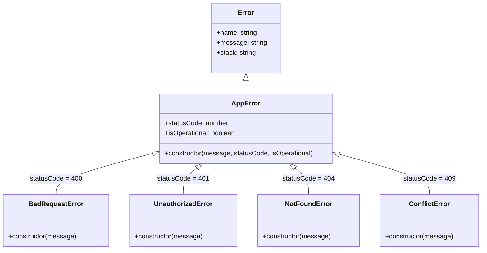

# AtHand — Error Handling Architecture & Patterns

## 1. Backend Error Hierarchy

The backend implements an object-oriented error inheritance tree rooted in `AppError`:



### Core Error Classes (`server/src/shared/errors/`)

1. **`AppError` (`AppError.ts`)**:
   ```typescript
   export class AppError extends Error {
       constructor(
           public message: string,
           public statusCode: number,
           public isOperational: boolean = true
       ) {
           super(message);
           Object.setPrototypeOf(this, new.target.prototype);
           Error.captureStackTrace(this);
       }
   }
   ```
2. **`BadRequestError` (HTTP 400)**: Thrown on invalid client input or failed domain assertions (e.g., "User already exist").
3. **`UnauthorizedError` (HTTP 401)**: Thrown when tokens or credentials are invalid or expired.
4. **`NotFoundError` (HTTP 404)**: Thrown when a queried entity does not exist.
5. **`ConflictError` (HTTP 409)**: Thrown when a duplicate key constraint or state conflict occurs.

---

## 2. Global Error Handling Middleware

All unhandled exceptions in asynchronous Express route handlers propagate to the global error middleware mounted at the tail of `src/app.ts`:

```typescript
// server/src/shared/middleware/ErrorMiddleware.ts
export const errorHandler = (
    err: Error,
    req: Request,
    res: Response,
    next: NextFunction
) => {
    console.error(err);

    if (err instanceof AppError) {
        res.status(err.statusCode).json({
            success: false,
            message: err.message
        });
        return;
    }

    res.status(HttpStatus.INTERNAL_SERVER_ERROR).json({
        success: false,
        message: "Internal Server Error"
    });
};
```

---

## 3. Schema Validation Error Formatting

Request bodies validated via Zod schemas pass through `ValidationMiddleware.ts`:

```typescript
// server/src/shared/middleware/ValidationMiddleware.ts
export const validate = (schema: ZodType) => 
    (req: Request, res: Response, next: NextFunction): void => {
        try {
            req.body = schema.parse(req.body);
            next();
        } catch (error) {
            if (error instanceof ZodError) {
                ResponseHandler.error(res, HttpStatus.BAD_REQUEST, "Validation failed",
                    error.issues.map((issue) => ({
                        field: issue.path.join("."),
                        message: issue.message,
                    }))
                );
                return;
            }
            next(error);
        }
    };
```

### Response on Validation Failure:
```json
{
  "success": false,
  "message": "Validation failed",
  "errors": [
    {
      "field": "email",
      "message": "Invalid email address format"
    },
    {
      "field": "phone",
      "message": "Phone number must be exactly 10 digits"
    }
  ]
}
```

---

## 4. Frontend Error Handling & Toast Feedback

1. **Toast Notifications (`react-hot-toast`)**:
   - Asynchronous API calls in components wrap actions in `try...catch` blocks.
   - User-facing error toasts are triggered using `toast.error(error.message || 'Failed to ...')`.
2. **Form Errors (`react-hook-form` + `@hookform/resolvers/zod`)**:
   - Field validation errors are displayed immediately below individual input components using `<InputField error={errors.fieldName?.message} />`.
3. **Missing Global Interceptor**:
   - Currently, `client/src/services/axios.ts` lacks an Axios response error interceptor. Network disconnects or unhandled 500 errors must be caught manually in each component, leading to repetitive error handling.
