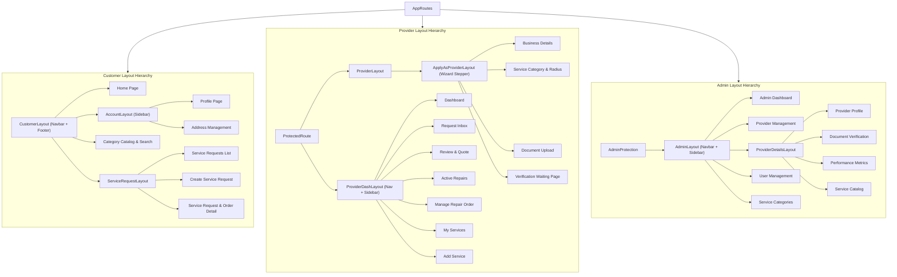
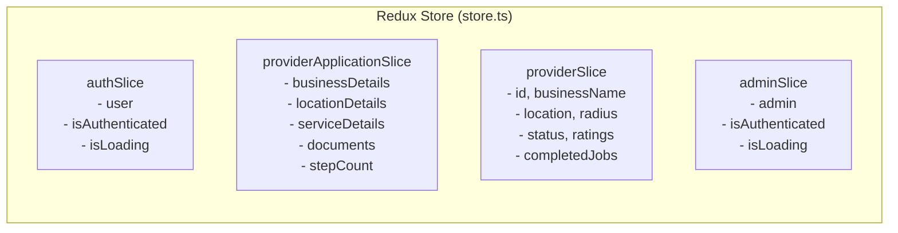
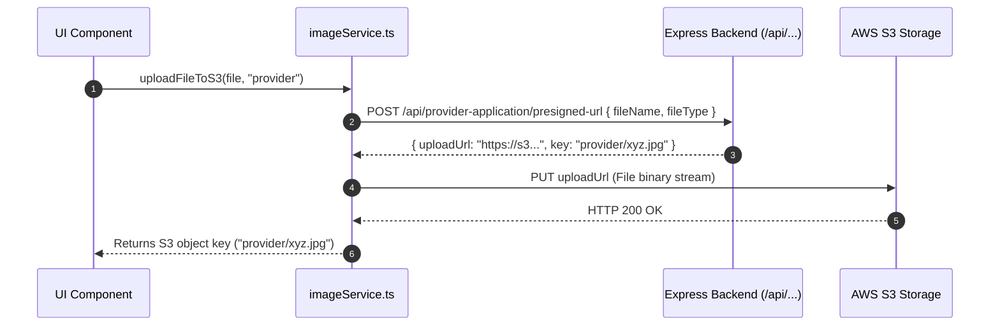

# AtHand — Frontend Architecture & UI Design

## 1. Application Entry Point & Bootstrapping

The client is a single-page application (SPA) built with **React 19**, **TypeScript**, and **Vite**:

```
index.html
└── src/app/main.tsx
    ├── <Provider store={store}>            (Redux Toolkit Context)
    │   └── <BrowserRouter>                 (React Router v7 Context)
    │       └── <App />                     (App Shell)
    │           ├── <Toaster />             (Global Toast Alerts)
    │           ├── <AuthInitializer>      (Initial Session Rehydration)
    │           │   └── <GoogleOAuthProvider> (Google Identity Context)
    │           │       └── <AppRoutes />   (Root Route Switcher)
```

---

## 2. Layouts & Visual Hierarchy

The application structures pages using nested layout wrappers that render common navigational headers, sidebars, and footers via `<Outlet />`:



---

## 3. State Management Architecture

The global Redux store (`src/store/store.ts`) organizes state into four modular feature slices:



| Slice | Key Actions | Primary Consumers |
| :--- | :--- | :--- |
| `auth` | `loginSuccess`, `logout`, `updateUser`, `setIsLoading` | `Navbar`, `Login`, `Register`, `ProtectedRoute`, `Profile` |
| `admin` | `adminloginSuccess`, `adminlogout`, `adminSetIsLoading` | `AdminProtection`, `AdminNavbar`, `AdminLogin` |
| `provider` | `setProvider`, `clearProvider`, `setLoading` | `Navbar`, `ProviderDashRoutes`, `RequestInbox`, `ManageRepairOrder` |
| `providerApplication` | `setBusinessDetails`, `setLocationDetails`, `setServiceDetails`, `addDocument`, `removeDocument`, `clearProviderApplication` | `BusinessDetails`, `ServiceDetails`, `UploadDocuments`, `ProgressBar` |

---

## 4. API & Data Fetching Architecture

All HTTP requests pass through the unified Axios instance configured in `src/services/axios.ts`:

```typescript
import axios from "axios";
export const api = axios.create({
    baseURL: import.meta.env.VITE_API_URL,
    withCredentials: true
});
```

### Feature API Adapters
Each feature module defines a clean, typed API client wrapper around `api`:
- `features/auth/api/authApi.ts`: Low-level auth HTTP requests.
- `features/admin/api/adminApi.ts`: Administrative management endpoints.
- `features/customer/service-request/api/serviceRequestApi.ts`: Request CRUD and queries.
- `features/customer/service-request/api/orderApi.ts`: Order management and state transitions.
- `features/provider/dashboard/apis/providerServiceApi.ts`: Technician-side service and request queries.
- `features/provider/dashboard/apis/quoteApi.ts`: Technician quoting endpoints.

### S3 Upload Pipeline (`src/services/imageService.ts`)


---

## 5. Styling & Design System

- **Tailwind CSS v4**: Utilizes `@tailwindcss/vite` without legacy `tailwind.config.js`. CSS directives and custom variables are imported directly in `src/styles/globals.css`.
- **Component Design Paradigm**:
  - Consistent border radii (`rounded-2xl`, `rounded-3xl`, `rounded-[2.5rem]`).
  - Subtle frosted glass aesthetic (`bg-white/80`, `bg-white/90`, `backdrop-blur-sm`).
  - Gradient canvas backgrounds (`from-[#d4f0ff] via-[#e4f6fb] to-[#f6fbe3]`).
  - High-contrast, accessibility-focused status badges.
- **Iconography**: Standardized on `lucide-react` for SVG icons across all modules.
- **Interactive Maps**: `react-leaflet` with OpenStreetMap tiles for technician location picking and customer service location visualization.
