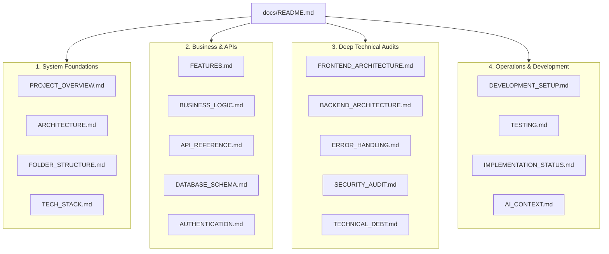

# AtHand — Technical Documentation Index

Welcome to the official technical documentation for **AtHand**, an on-demand repair service platform built on Node.js, Express, React 19, MongoDB, and TypeScript.

This documentation suite serves two primary purposes:
1. **Developer Reference**: Provides in-depth architecture, domain logic, database schemas, and API references for maintaining and extending the platform.
2. **Persistent AI Context**: Serves as structured, persistent context for Antigravity AI pair programming sessions via [`AI_CONTEXT.md`](AI_CONTEXT.md).

---

## Documentation Navigation Map

---

## Document Index & Descriptions

| Document | Purpose & Key Topics |
| :--- | :--- |
| **[`AI_CONTEXT.md`](AI_CONTEXT.md)** | **Crucial File for AI Sessions.** Concise yet complete project context, conventions, rules for modification, and architecture summary. |
| **[`PROJECT_OVERVIEW.md`](PROJECT_OVERVIEW.md)** | Business vision, problem statement, core value propositions, and user personas. |
| **[`ARCHITECTURE.md`](ARCHITECTURE.md)** | High-level system architecture, request lifecycle, data flow, Clean Architecture layers, and Mermaid diagrams. |
| **[`FOLDER_STRUCTURE.md`](FOLDER_STRUCTURE.md)** | Complete directory tree breakdown explaining the responsibility of every directory in `server/` and `client/`. |
| **[`TECH_STACK.md`](TECH_STACK.md)** | Exact verified library versions, packages, usage locations, and dependency audit. |
| **[`FEATURES.md`](FEATURES.md)** | Granular feature inventory with implementation status (fully implemented, partially implemented, mocked, etc.). |
| **[`BUSINESS_LOGIC.md`](BUSINESS_LOGIC.md)** | Core domain workflows, user roles, permissions, business rules, and state machines for requests, quotes, and orders. |
| **[`API_REFERENCE.md`](API_REFERENCE.md)** | Comprehensive REST API catalog for all endpoints across all 12 modules with parameters, bodies, and error formats. |
| **[`DATABASE_SCHEMA.md`](DATABASE_SCHEMA.md)** | Full MongoDB collection schemas (10 Mongoose models), indexes, 2dsphere spatial queries, and Mermaid ER diagram. |
| **[`AUTHENTICATION.md`](AUTHENTICATION.md)** | OTP email verification, dual-context cookies (`accessToken`, `adminAccessToken`), Redis session tracking, and Google OAuth2. |
| **[`FRONTEND_ARCHITECTURE.md`](FRONTEND_ARCHITECTURE.md)** | React 19 SPA structure, Redux Toolkit slices, layout hierarchies, custom hooks, and Tailwind CSS v4 styling. |
| **[`BACKEND_ARCHITECTURE.md`](BACKEND_ARCHITECTURE.md)** | Clean Architecture / DDD layer implementation, manual DI composition roots (`container.ts`), mappers, and CLI scaffolding. |
| **[`ERROR_HANDLING.md`](ERROR_HANDLING.md)** | `AppError` inheritance hierarchy, global Express error middleware, Zod validation formatting, and client toast feedback. |
| **[`SECURITY_AUDIT.md`](SECURITY_AUDIT.md)** | Vulnerability findings categorized from Critical to Low, with evidence, potential impact, and remediation steps. |
| **[`DEVELOPMENT_SETUP.md`](DEVELOPMENT_SETUP.md)** | Local development environment setup, prerequisites, environment variables, startup commands, and build troubleshooting. |
| **[`TESTING.md`](TESTING.md)** | Quality assurance audit, test coverage assessment (currently 0%), ESLint report, and recommended testing roadmap. |
| **[`TECHNICAL_DEBT.md`](TECHNICAL_DEBT.md)** | Code smells, schema inconsistencies, compilation failures, race conditions, and suggested improvements. |
| **[`IMPLEMENTATION_STATUS.md`](IMPLEMENTATION_STATUS.md)** | Production readiness scorecard, verified TODO comments in code, and prioritized future roadmap. |
| **[`CHANGELOG.md`](CHANGELOG.md)** | Audit history, repository version milestones, and structural change tracking. |
